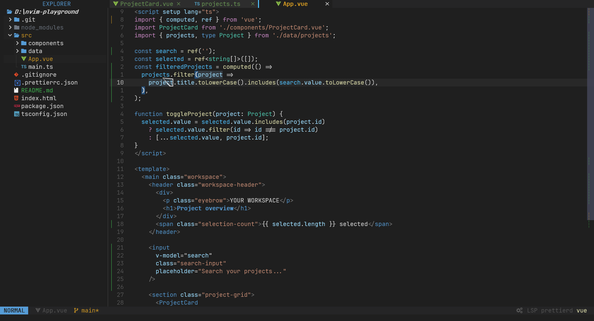
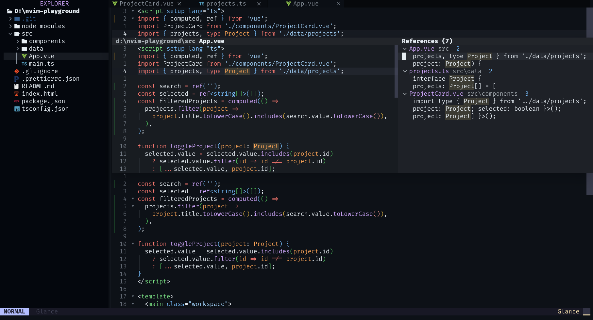
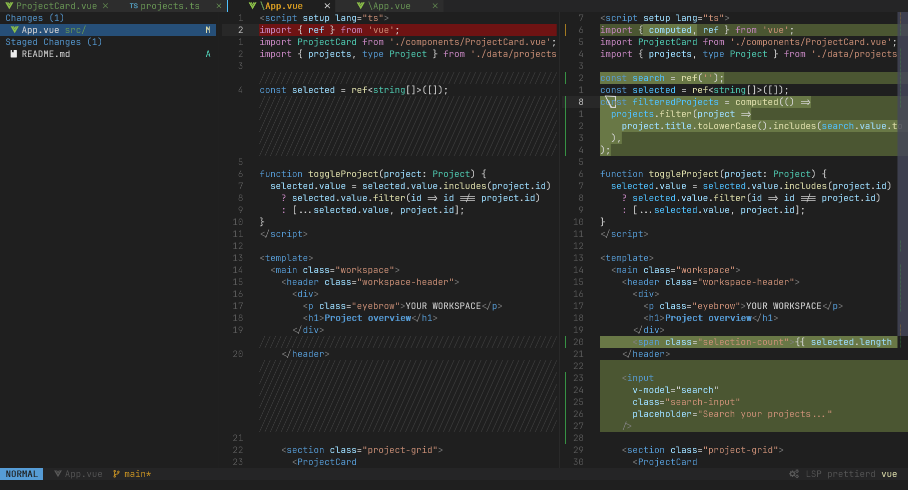
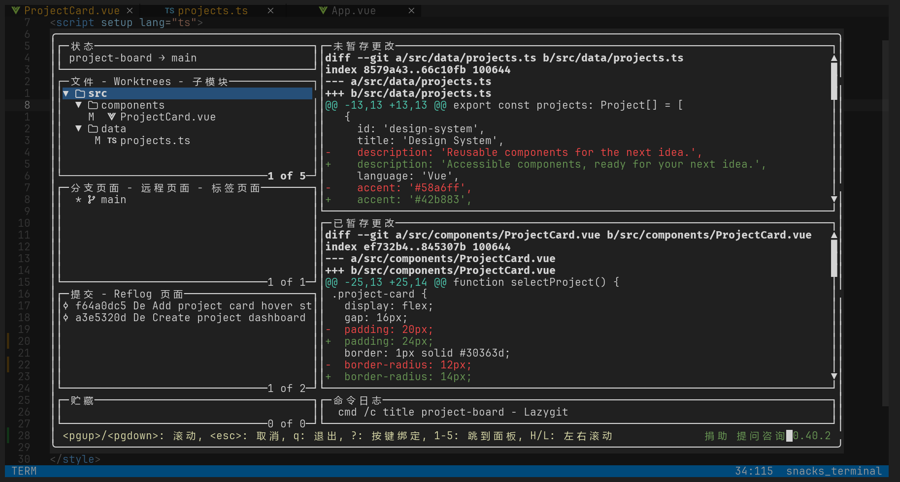

# Neovim 配置

## Leader 组合键

`<leader>` 是空格，按下后会显示后续可用按键。`A`、`C`、`S` 分别表示 Alt、Ctrl、Shift。

按 `Space + ?` 打开 Alt 快捷键速查，默认用 `j/k` 浏览，按 `i` 输入按键名或中文说明筛选，`Esc` 关闭；`?` 即 `Shift+/`。

模式：`n` 普通，`i` 插入，`v/x` 可视，`o` 操作符等待，`c` 命令行。

| 分组 | 按键 | 模式 | 功能 |
| --- | --- | --- | --- |
| 文件 `f` | `<leader>ff` | n | 文件搜索 |
| 文件 `f` | `<leader>fp` | n | 项目选择 |
| 搜索 `s` | `<leader>sg` | n | 全局文本搜索 |
| 搜索 `s` | `<leader>sr` | n, v | 搜索替换，默认当前文件 |
| 搜索 `s` | `<leader>sn` | n | 通知历史 |
| 搜索 `s` | `<leader>su` | n | 撤销历史 |
| 搜索 `s` | `<leader>sc` | n | 选择配色主题 |
| 代码 `c` | `<leader>co` | n | 代码大纲 |
| 代码 `c` | `<leader>ch` | n | 悬停文档 |
| 跳转 `j` | `<leader>jj` | n, x, o | 按字符标签跳转 |
| 跳转 `j` | `<leader>js` | n, x | 按标签选择或扩展选区 |
| 跳转 `j` | `<leader>jw` | n, x, o | 下一个子词开头 |
| 跳转 `j` | `<leader>jb` | n, x, o | 上一个子词开头 |
| 跳转 `j` | `<leader>je` | n, x, o | 子词末尾 |
| 窗口 `w` | `<leader>wv` | n | 垂直分屏 |
| 窗口 `w` | `<leader>ws` | n | 水平分屏 |
| 窗口 `w` | `<leader>wr` | n | 重新打开上一个关闭的文件 |
| 调试 `d` | `<leader>db` | n | 切换断点 |
| Git `g` | `<leader>gt` | n | Git 终端界面 |
| Git `g` | `<leader>gd` | n | 查看差异 |
| Git `g` | `<leader>gh` | n | Git 历史 |
| 诊断 `x` | `<leader>xf` | n | 当前文件诊断 |
| 诊断 `x` | `<leader>xx` | n | 工作区诊断 |
| 退出 `q` | `<leader>qa` | n | 退出全部窗口 |

也可使用原生命令退出：`:q` 关闭当前窗口，`:qa` 退出全部窗口。

搜索列表中，按 `i` 输入搜索词，`Enter` 确认选择。配色选择中，上下移动预览，`Enter` 确认，`Esc` 取消。

折叠：`za` 切换当前块，`zc` / `zo` 收起 / 展开当前块，`zM` / `zR` 全部收起 / 展开。

子词移动识别驼峰、下划线和数字边界；可配合 `v`、`d`、`c` 选中、删除或修改，例如 `d<leader>je`。

## 代码导航与诊断

| 按键 | 功能 |
| --- | --- |
| `gd` | 转到定义：单个结果直接跳转，多个结果打开预览 |
| `grr` | 查找引用 |
| `gri` | 查找实现 |
| `grt` | 查看类型定义 |
| `grn` | 重命名符号或标签 |
| `gra` | 代码操作，支持普通及可视模式 |
| `grx` | CodeLens 操作，仅 Neovim，需语言服务器支持 |
| `[x` / `]x` | 上一条 / 下一条诊断 |

| 使用位置 | 操作 |
| --- | --- |
| 定义、引用、实现、类型定义的结果列表 | `j/k` 选择，`Enter` 跳转，`q/Esc` 关闭；`Ctrl+H` 查看代码，`Ctrl+L` 返回列表；`h/l` 折叠 / 展开文件组 |
| 代码大纲 | `j/k` 选择，`i` 搜索，`Ctrl+L` 进入预览，`Ctrl+H` 返回列表；`Enter` 跳转，`q/Esc` 关闭 |
| 代码操作 | `j/k` 选择，`Enter` 执行，`Esc` 关闭 |

HTML/Vue 的代码操作包含删除标签、移除外层标签、转换空标签和添加外层标签。

## 编辑与移动

| 按键 | 模式 | 功能 |
| --- | --- | --- |
| `<Enter>` | n / i | 在光标后进入插入 / 换行或确认补全 |
| `<Esc>` | n | 关闭悬停文档、取消片段或多光标、清除搜索高亮（保留搜索词） |
| `J` / `K` | n | 下翻 / 上翻半页，无动画 |
| `gh` / `gl` | n, v | 行首非空白处 / 行尾 |
| `G` / `gg` | n, v | 文件开头 / 文件结尾 |
| `<A-a>` | n | 全选 |
| `<A-s>` | n, i, v | 保存 |
| `<A-z>` / `<A-y>` | n, i, v | 撤销 / 重做 |
| `<A-u>` / `<A-i>` | n | 后退 / 前进跳转位置 |
| `<A-j>` / `<A-k>` | n, v | 向下 / 向上移动行或选区 |
| `<A-d>` | n, i / v | 删除行 / 删除选区 |
| `<A-x>` | n / v | 剪切行 / 剪切选区到系统剪贴板 |
| `<A-c>` | v | 复制到系统剪贴板 |
| `<A-v>` | n, i, x, c | 粘贴；可视模式替换选区并保留剪贴板 |
| `<A-/>` | n, x | 注释当前行 / 选中多行 |
| `<A-F>` | n, i | 格式化，即 Alt+Shift+F |
| `<A-f>` | n | 搜索当前文件，回车确认后用 `n/N` 继续查找 |

`u`、`<C-r>`、`dd` 及 PageUp/PageDown 已禁用。`s` 使用原生行为：删除光标处字符并进入插入模式。`D` 删除到行尾并保持普通模式。使用 `x/c/d` 删除或修改文本时不覆盖剪贴板。

也可用 `gcc` 注释当前行、`gc{motion}` 注释指定范围；换行不自动续写注释前缀。

保存时自动格式化，也可按 `<A-F>` 手动格式化。

输入 `>` 自动闭合标签；输入 `</` 后可从补全菜单选择标签名。

## 窗口、文件标签与终端

| 按键 | 功能 |
| --- | --- |
| `<C-h>` / `<C-j>` / `<C-k>` / `<C-l>` | 跳到左 / 下 / 上 / 右窗口 |
| `<A-Up>` / `<A-Down>` | 增加 / 减少窗口高度 |
| `<A-Left>` / `<A-Right>` | 减少 / 增加窗口宽度 |
| `<A-h>` / `<A-l>` | 上一个 / 下一个文件标签 |
| `Alt+<` / `Alt+>` | 左移 / 右移文件标签 |
| `<A-1>` ～ `<A-3>` | 第 1～3 个文件标签 |
| `<A-p>` | 固定 / 取消固定文件标签 |
| `<A-w>` | 多窗口时关闭当前窗口；最后一个窗口关闭文件并保留布局 |
| `<A-b>` / `<A-e>` | 切换文件树 / 定位当前文件 |
| `<A-t>` | 切换终端，普通及终端模式可用 |
| `<A-g>` | 切换 opencode 终端，普通及终端模式可用 |

按 `<A-w>` 关闭帮助、quickfix、文件树或浮窗。

`<leader>wr` 重新打开本次运行中最近关闭的文件，连续按可依次恢复多个文件。单独关闭分屏不计入文件关闭记录。

## 多光标

| 按键 | 模式 | 功能 |
| --- | --- | --- |
| `gb` | n, x, i | 选中当前词 / 选区，再按选择下一个相同内容 |
| `<A-J>` / `<A-K>` | n, x, i | 向下 / 向上添加光标，即 Alt+Shift+J/K |
| `mc` | n, x | 手动添加光标；Neovim 中再次按下可移除 |
| `mm` | n, x | Neovim 中启用全部光标并一起移动 |
| `mi` / `ma` | n, x | 在所有光标前 / 后插入 |

普通模式按 `Esc` 退出多光标，插入模式按两次 `Esc`。

## 语法选区与文本对象

光标位于代码块内部时，高亮最近包住光标的一对 `{}`、`()` 或 `[]`；普通与插入模式均生效。

可视模式下按 `Enter` 逐级扩选，按 `Backspace` 沿原路径回缩。

下表内部 / 整体对象用于 `x/o`，跳转用于 `n/x/o`。例如 `daf` 删除整个函数，`vas` 选中整条语句。

| 对象 | 内部 | 整体 | 上一个 | 下一个 |
| --- | --- | --- | --- | --- |
| 函数 / 方法 | `if` | `af` | `[f` | `]f` |
| 循环 | `il` | `al` | `[l` | `]l` |
| 条件分支 | `id` | `ad` | `[d` | `]d` |
| 方法调用 | `ic` | `ac` | `[c` | `]c` |
| 参数 | `ia` | `aa` | `[a` | `]a` |
| 语句 / 声明 | `is` | `as` | `[s` | `]s` |
| 成对括号 | `ib` | — | `[b` | `]b` |
| 成对引号 | `iq` | — | `[q` | `]q` |

`as` 选择整条语句，`is` 不含末尾分号。例如 `vis` 选中当前语句内容。

Vue 模板中，`al/ad` 选择整个带 `v-for` 或 `v-if/v-else-if/v-else` 的元素，`il/id` 选择标签之间的内容。自闭合或空元素没有内部选区。

`ib` / `iq` 优先选择当前行内包含光标或选区的对象，其次选择下一个；当前行找不到时向前后 50 行搜索。光标位于括号字符时，`i%` 可选中内部内容。

`[b` / `]b` 和 `[q` / `]q` 分别跳到括号、引号的起始位置，支持嵌套括号。

`;` / `,` 向后 / 向前重复结构跳转。`f/t` 向后查找字符 / 字符前，`F/T` 向前查找字符 / 字符后；仅限当前行。

## Git 操作

`<leader>gt` 打开 LazyGit，`<leader>gd` / `<leader>gh` 查看差异与历史。

差异视图中，`]c` / `[c` 切换差异块，`]f` / `[f` 切换文件，`q` 或 `<A-w>` 退出。

## 补全与调试

| 按键 | 模式 | 功能 |
| --- | --- | --- |
| `<C-e>` | i | 关闭补全菜单 |
| `<A-j>` / `<A-k>` 或上下方向键 | i, c | 下一条 / 上一条补全 |
| `<Tab>` / `<S-Tab>` | n | 片段激活时，跳到下一个 / 上一个占位符 |
| `<Tab>` | i, c | 插入模式依次确认补全、跳到下一片段位置、跳过紧邻的右括号或引号，否则缩进；命令行显示补全 |
| `<S-Tab>` | i | 回到上个片段位置 |
| `<F5>` | n | 启动 / 继续调试；Rust 首次选择 Cargo 调试目标 |
| `<F10>` / `<F11>` / `<F12>` | n | 单步越过 / 进入 / 跳出 |

按 `Esc` 退出插入模式后仍可跳转片段；在普通模式再按 `Esc` 结束片段。

输入标签、样式缩写或 UnoCSS 类名前缀后，选择补全候选，按 `Tab` 或 `Enter` 确认。

Node.js 调试出现线程选择菜单时，选择 `Resume stopped thread` 继续运行。

## 安装与维护

| 环境 | 要求 |
| --- | --- |
| 通用 | Neovim 0.12+、Git、Node.js/npm（可复用已有兼容版本）、ripgrep、C 编译器、tar、curl、解压工具，均需加入 PATH |
| Windows | 可用 Scoop：`scoop install neovim git nodejs-lts ripgrep gcc` |
| Windows 终端 | PowerShell + [inshellisense](https://github.com/microsoft/inshellisense)：`npm install -g @microsoft/inshellisense` |
| macOS | `brew install neovim git node ripgrep`；编译器用 Xcode Command Line Tools（`xcode-select --install`） |
| 可选 | 7-Zip（解压）、Nerd Font（图标）、Neovide、LazyGit、opencode CLI；VS Code 需 vscode-neovim 扩展 |
| Rust | 另装 Rust 工具链、rust-analyzer、rustfmt；Windows/MSVC 还需 C++ Build Tools 和 Windows SDK |

将[本仓库](https://github.com/so11y/nvim)克隆到 Windows 的 `%LOCALAPPDATA%\nvim` 或 macOS 的 `~/.config/nvim`，然后启动 `nvim`。已有配置先备份，安装需访问 GitHub 和 npm。

| 操作 | 命令 |
| --- | --- |
| 首次安装 | `:Lazy install`，完成后重启 |
| 更新插件 | `:Lazy update` |
| 补装或对齐语言工具 | `:Lazy build mason.nvim` |
| 补装或更新解析器 | `:Lazy build nvim-treesitter` |

普通启动不自动补装；修改工具清单或版本锁后，重启再 Build。失败查看 `:Lazy`、`:MasonLog`；VS Code 用户先在独立 Neovim 中完成安装。

回归测试与维护脚本见[验证说明](scripts/verification/README.md)。
