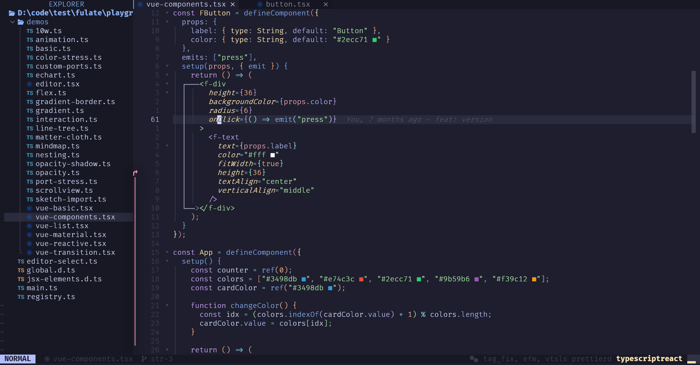
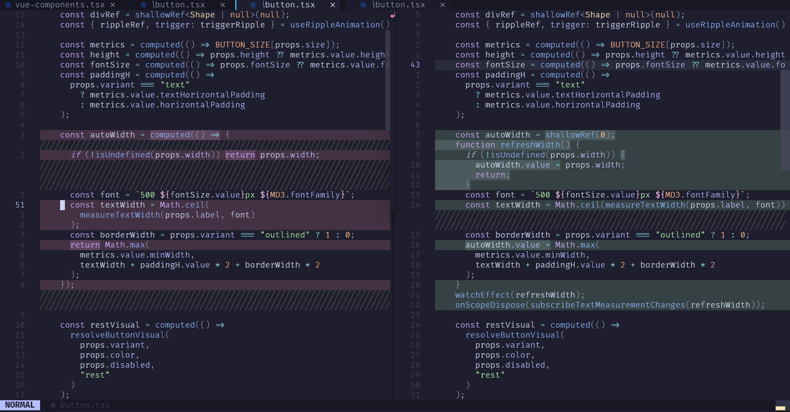
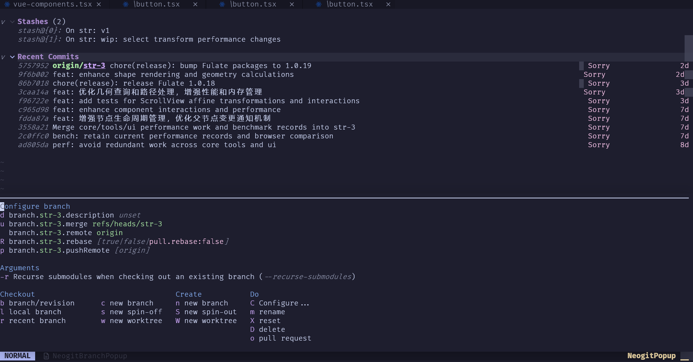

# Neovim 配置



## 安装与维护

支持 Windows 和 macOS，使用 Neovim 0.12+。基础工具由系统包管理器安装，插件、语言工具和解析器由你通过 Lazy 主动安装。语言服务器、格式化工具和调试适配器交给 Mason，解析器交给 Tree-sitter。已有配置请先备份；安装需要访问 GitHub 和 npm。

### Windows

已安装 [Scoop](https://scoop.sh/) 时，在 PowerShell 中执行：

```powershell
scoop install neovim git nodejs-lts ripgrep gcc 7zip
git clone https://github.com/so11y/nvim.git "$env:LOCALAPPDATA\nvim"
nvim
```

也可以使用已有的 Winget、Chocolatey 或其他安装方式。确保 `nvim`、`git`、`node`、`npm`、`rg`、C 编译器及解压工具在 PATH 中；Windows 10/11 提供的 `tar`、`curl` 也需要可用。配置复用现有编译器，保留显式 `CC`，没有设置 `CC` 时会采用 PATH 中的 GCC。

### macOS

已安装 [Homebrew](https://brew.sh/) 时执行：

```sh
brew install neovim git node ripgrep
git clone https://github.com/so11y/nvim.git ~/.config/nvim
nvim
```

编译器使用 Xcode Command Line Tools 提供的 Clang；未安装时运行 `xcode-select --install`。Node.js 使用仍在维护的版本；`tar` 和 `curl` 使用系统工具。

### 首次启动与更新

首次运行 `nvim` 会引导 lazy.nvim；进入 `:Lazy` 管理界面，执行 `:Lazy install` 安装缺失插件。相关构建钩子会安装语言工具及解析器。普通启动只初始化已安装的插件，不自动补装插件、工具或解析器，也不对齐工具版本。

| 操作 | 命令 |
| --- | --- |
| 首次安装插件 | `:Lazy install` |
| 更新插件 | `:Lazy update` |
| 补装语言工具、应用工具清单或兼容版本 | `:Lazy build mason.nvim` |
| 补装、更新解析器 | `:Lazy build nvim-treesitter` |

Install／Sync 不保证重建已经安装的插件；补装或重试请执行对应的 Build。修改配置清单或版本锁后，重启以加载配置，再执行 Build。安装失败查看 `:Lazy`、`:MasonLog` 和 `:messages`；诊断使用 `:checkhealth lazy mason nvim-treesitter conform`。

运行 `:echo stdpath('data')` 查看安装位置：该目录的 `lazy/` 存放插件，`mason/` 存放语言工具，`site/` 存放解析器和查询文件。

首次安装结束后重启 Neovim，再开始编辑。构建失败可再次手动执行 Build。安装进程被强制中断后，如 Mason 报残留锁，确认其他安装进程已结束，再使用原生 `:MasonInstall --force 包名` 重装。

插件由 `lazy-lock.json` 记录提交，更新并验证后提交新的版本锁。Mason 工具清单位于 `lua/config/mason_tools.lua`；构建时只补齐缺失的普通工具，后续通过 `:Mason` 更新。`tools.lock.json` 只锁定 vtsls、Vue language server 和 TypeScript SDK 的兼容组合，执行 Mason Build 时会对齐这组版本。Mason 使用原生包名，例如 `:MasonInstall vue-language-server`；LSP 由 `vim.lsp.enable` 启用。`:ConformInfo` 查看格式化工具。

系统工具使用 `scoop update` 或 `brew upgrade` 维护，配置不下载或托管 Neovim、Node、编译器和各平台编译产物。

### 特殊依赖与可选功能

- Vue 使用配套版本的 vtsls、Vue language server 和 TypeScript SDK；Mason 安装时补齐服务器目录中的 SDK，vtsls 固定使用这份 SDK，以保持路径补全行为一致。保留的 Mason 编译器适配只补齐这个 SDK，工具版本通过 Mason 原生安装参数指定。
- 格式化使用 Conform 调用 prettierd、StyLua，Rust 使用语言服务器；沿用项目配置、保存格式化、错误通知及失败时保留原文。已移除 EFM 自编译补丁，基础安装不需要 Go。
- Rust 项目需要自己的 Rust 工具链；使用 Rustup 时运行 `rustup component add rust-analyzer rustfmt`，项目的工具链选择由 Rustup 管理。Windows 的 MSVC 工具链还需要 C++ Build Tools 和 Windows SDK，见 [Rustup 要求](https://rust-lang.github.io/rustup/installation/windows-msvc.html)；链接器环境不完整时从 Visual Studio 开发者终端启动 Neovim。
- 图标需要终端使用 Nerd Font。Neovide 默认使用 FiraCode Nerd Font；Neovide、LazyGit 和 opencode CLI 按用途通过系统包管理器安装。
- VS Code 使用 vscode-neovim 扩展。先在独立 Neovim 中通过 Lazy 完成安装，再配置扩展使用系统 Neovim；补全、格式化及界面由 VS Code 提供。
- Windows 暂停 Lua 磁盘缓存，避免缓存编码完整路径后超过 Windows 路径长度限制；macOS 保留默认缓存。
- 手动安装模式会暂停未安装插件的延迟事件，安装完成后恢复，保证首次打开 Lazy 管理界面时不会被缺失插件的事件阻断。

直接运行 PATH 中的 `nvim` 或 `neovide`。配置遵循 Neovim 的标准目录；使用其他配置命名时按照 `NVIM_APPNAME` 选择对应目录。

维护者可在配置目录运行 `nvim --headless -i NONE -c "Lazy! install" -c "Lazy! build mason.nvim nvim-treesitter" -c "lua dofile('scripts/verification/installation.lua')"` 显式安装并验证工具、解析器和 Lua 语法。编辑功能回归位于 `scripts/verification`。

## Leader 组合键

which-key 按功能显示可用的 Leader 快捷键。

| 分组 | 按键 | 模式 | 功能 |
| --- | --- | --- | --- |
| 文件 `f` | `<leader>ff` | n | 文件搜索 |
| 文件 `f` | `<leader>fp` | n | 项目选择 |
| 搜索 `s` | `<leader>sg` | n | 全局文本搜索 |
| 搜索 `s` | `<leader>sr` | n, v | 搜索替换，默认当前文件 |
| 搜索 `s` | `<leader>sn` | n | 通知历史 |
| 搜索 `s` | `<leader>su` | n | 撤销历史 |
| 搜索 `s` | `<leader>sc` | n | 配色主题，支持预览并记住选择 |
| 代码 `c` | `<leader>co` | n | 代码大纲 |
| 代码 `c` | `<leader>ch` | n | 折叠预览；无折叠时显示 Hover |
| 跳转 `j` | `<leader>jj` | n, x, o | Flash 跳转 |
| 跳转 `j` | `<leader>js` | n, x | Flash 选区 |
| 跳转 `j` | `<leader>jw` | n, x, o | 下一个子词开头 |
| 跳转 `j` | `<leader>jb` | n, x, o | 上一个子词开头 |
| 跳转 `j` | `<leader>je` | n, x, o | 子词末尾 |
| 窗口 `w` | `<leader>wv` | n | 垂直分屏 |
| 窗口 `w` | `<leader>ws` | n | 水平分屏 |
| 窗口 `w` | `<leader>wr` | n | 重新打开上一个关闭的文件 |
| 调试 `d` | `<leader>db` | n | 切换断点 |
| Git `g` | `<leader>gt` | n | LazyGit |
| Git `g` | `<leader>gn` | n | Neogit |
| Git `g` | `<leader>gd` | n | CodeDiff 差异 |
| Git `g` | `<leader>gh` | n | Git 历史 |
| 诊断 `x` | `<leader>xf` | n | 当前文件诊断 |
| 诊断 `x` | `<leader>xx` | n | 工作区诊断 |
| 退出 `q` | `<leader>qq` | n | 退出 Neovim |

配色菜单提供 Catppuccin 和 GitHub Theme 的各个款式。上下移动可预览，回车确认并保存，`Esc` 取消；首次默认使用 Catppuccin。

再次按 `<leader>ch` 进入预览浮窗，按 `Esc` 关闭。

子词移动识别驼峰、下划线和数字边界；可配合 `v`、`d`、`c` 选中、删除或修改，例如 `d<leader>je`。

## LSP 与诊断

| 按键 | 功能 |
| --- | --- |
| `gd` | 定义 |
| `grr` | 引用 |
| `gri` | 实现 |
| `grt` | 类型定义 |
| `grn` | 重命名 |
| `gra` | 代码操作，支持普通及可视模式 |
| `grx` | CodeLens 操作，仅 Neovim，需语言服务器支持 |
| `[x` / `]x` | 上一条 / 下一条诊断 |

`grn` 支持重命名 Vue 标签和代码符号。在 HTML/Vue 文件中，`gra` 菜单提供删除标签、移除外层标签、转换空标签和 Emmet 包裹操作。

独立编辑器的 `gra` 动作菜单横向居中对齐光标，优先显示在下方；最多显示 8 条，超过时显示滚动条。上下方向键或 `Ctrl+J/K` 选择，`Enter/Tab` 执行，`Esc` 关闭。菜单沿用 Blink 配色，无搜索栏和预览。

## 编辑与移动

| 按键 | 模式 | 功能 |
| --- | --- | --- |
| `<Enter>` | n / i | 在光标后进入插入 / 换行或确认补全 |
| `<Esc>` | n | 关闭 Hover、取消多光标或清除搜索 |
| `J` / `K` | n | 下翻 / 上翻半页 |
| `gh` / `gl` | n, v | 行首非空白处 / 行尾 |
| `G` / `gg` | n, v | 文件开头 / 文件结尾 |
| `<A-a>` | n | 全选 |
| `<A-s>` | n, i, v | 保存 |
| `<A-z>` / `<A-y>` | n, i, v | 撤销 / 重做 |
| `<A-u>` / `<A-i>` | n | 后退 / 前进跳转位置 |
| `<A-j>` / `<A-k>` | n, v | 向下 / 向上移动行或选区 |
| `<A-d>` | n, i / v | 删除行 / 删除选区 |
| `<A-x>` | n / v | 剪切行 / 剪切选区到系统剪贴板 |
| `<A-c>` | v | 复制到系统剪贴板 |
| `<A-v>` | n, i, x, c | 粘贴；可视模式替换选区并保留剪贴板 |
| `<A-/>` | n, v | 切换行注释 |
| `gcO` / `gco` / `gcA` | n | 上方 / 下方 / 行尾添加注释 |
| `<A-F>` | n, i | 格式化，即 Alt+Shift+F |
| `<A-f>` | n | 当前文件内搜索 |

`u`、`<C-r>`、`dd` 及 PageUp/PageDown 已禁用。`s` 使用原生行为：删除光标处字符并进入插入模式。使用 `x/c/d` 删除或修改文本时不覆盖剪贴板。

保存时自动格式化，也可按 `<A-F>` 手动格式化。优先使用项目格式配置；格式化失败时显示通知并保留原内容。

标签在输入 `>` 时自动闭合；输入 `</` 时保留正常输入事件供 Blink 补全，不自动补齐标签名。

## 窗口、Buffer 与终端

| 按键 | 功能 |
| --- | --- |
| `<C-h>` / `<C-j>` / `<C-k>` / `<C-l>` | 跳到左 / 下 / 上 / 右窗口 |
| `<A-Up>` / `<A-Down>` | 增加 / 减少窗口高度 |
| `<A-Left>` / `<A-Right>` | 减少 / 增加窗口宽度 |
| `<A-h>` / `<A-l>` | 上一个 / 下一个 Buffer |
| `Alt+<` / `Alt+>` | 左移 / 右移 Buffer |
| `<A-1>` ～ `<A-3>` | 第 1～3 个 Buffer |
| `<A-p>` | 固定 / 取消固定 Buffer |
| `<A-w>` | 多编辑窗口时关闭窗口；最后一个编辑窗口删除 Buffer 并保留布局 |
| `<A-b>` / `<A-e>` | 切换文件树 / 定位当前文件 |
| `<A-t>` | 切换浮动终端，普通及终端模式可用 |
| `<A-g>` | opencode 浮动终端，普通及终端模式可用 |

按 `<A-w>` 关闭帮助、quickfix、文件树或浮窗。

`<leader>wr` 通过 buffer-reopen.nvim 在当前窗口重新打开本次运行中最近关闭的文件，连续按可依次恢复多个文件。历史只记录已从 Buffer 列表移除的普通文件；单独关闭分屏时文件仍在列表，不计入历史。标签栏关闭按钮和右键关闭使用 Snacks，未保存修改会提示保存、放弃或取消。VS Code 中调用“重新打开已关闭的编辑器”。

## 多光标

Neovim 使用 vim-visual-multi 实时同步多光标输入；VS Code 使用内置多光标。

| 按键 | 模式 | 功能 |
| --- | --- | --- |
| `gb` | n, x, i | 选中当前词 / 选区，再按选择下一个相同内容 |
| `<A-J>` / `<A-K>` | n, x, i | 向下 / 向上添加光标，即 Alt+Shift+J/K |
| `mc` | n, x | 手动添加光标；Neovim 中再次按下可移除 |
| `mm` | n, x | Neovim 中启用全部光标并一起移动 |
| `mi` / `ma` | n, x | 在所有光标前 / 后插入 |

普通模式按 `Esc` 退出多光标，插入模式按两次 `Esc`。Neovim 中输入、退格和换行实时同步，多光标编辑期间暂停补全与自动括号。

## 语法选区与文本对象

可视模式下按 `Enter` 逐级扩选，按 `Backspace` 沿原路径回缩。

下表内部 / 整体对象用于 `x/o`，跳转用于 `n/x/o`。例如 `daf` 删除整个函数，`vas` 选中整条语句。

| 对象 | 内部 | 整体 | 上一个 | 下一个 |
| --- | --- | --- | --- | --- |
| 函数 / 方法 | `if` | `af` | `[f` | `]f` |
| 循环 | `il` | `al` | `[l` | `]l` |
| 条件分支 | `id` | `ad` | `[d` | `]d` |
| 方法调用 | `ic` | `ac` | `[c` | `]c` |
| 参数 | `ia` | `aa` | `[a` | `]a` |
| 语句 / 声明 | `is` | `as` | `[s` | `]s` |
| 成对括号 | `ib` | — | `[b` | `]b` |
| 成对引号 | `iq` | — | `[q` | `]q` |

`as` 选择整条语句或声明；`is` 选择同一范围，仅排除语法上的末尾分号，保留 `let`、`return` 等关键字和赋值左侧。例如 `let x = foo();` 的 `vis` 选中 `let x = foo()`。没有末尾分号时，两者相同；不支持语句查询的语言不会回退到自然语言句子。

Vue 模板中，`al/ad` 选择整个带 `v-for` 或 `v-if/v-else-if/v-else` 的元素，`il/id` 选择标签之间的内容。自闭合或空元素没有内部选区，内部操作不会选中后面的元素。

`ib` / `iq` 优先选择当前行内包含光标或选区的对象，其次选择下一个；当前行找不到时向前后 50 行搜索。光标位于括号字符时，`i%` 可选中内部内容。

`[b` / `]b` 和 `[q` / `]q` 分别跳到括号、引号的起始位置，支持嵌套括号。

`;`、`,` 分别向后 / 向前重复结构跳转，不重复 Flash 字符查找。`f/t` 向后查找字符 / 字符前，`F/T` 向前查找字符 / 字符后；只查找当前行，每次输入目标字符，例如连续两次 `fe` 跳到后面的两个 `e`。跳转后立即清除背景和匹配高亮，不需要按回车结束，也不显示跳转标签。

## Git 操作

Neovim 使用 LazyGit 和 Neogit 管理 Git，使用 CodeDiff 查看差异。

CodeDiff 中 `]c` / `[c` 切换差异块，`]f` / `[f` 切换文件，`q` 或 `<A-w>` 退出差异页。

| Neogit 按键 | 功能 |
| --- | --- |
| `y` | 分支列表 |
| `b c` / `b l` | 选择起点创建并切换分支 / 切换分支 |
| `m m` | 合入分支 |
| `s` / `u` | 暂存 / 取消暂存当前文件或差异块 |
| `c c` | 编辑提交信息，连续两次 Ctrl+C 完成提交 |
| `f a` | 抓取所有远程 |
| `p u` / `P u` | 从上游拉取 / 推送到上游 |
| `d d` | CodeDiff 查看当前文件或提交差异 |
| `?` | 操作菜单 |





## 补全与调试

| 按键 | 模式 | 功能 |
| --- | --- | --- |
| `<C-e>` | i | 关闭 Blink 补全菜单 |
| `<A-j>` / `<A-k>` 或上下方向键 | i, c | 下一条 / 上一条补全 |
| `<Tab>` | i, c | 插入模式依次尝试：确认补全、跳到下一片段位置、在非空白字符后唤起补全，否则普通缩进；命令行可显示补全 |
| `<S-Tab>` | i | 回到上个片段位置 |
| `<F5>` | n | 启动 / 继续调试；Rust 首次选择 Cargo 调试目标 |
| `<F10>` / `<F11>` / `<F12>` | n | 单步越过 / 进入 / 跳出 |

Emmet 通过语言服务器提供补全候选，支持 HTML、Vue、JSX/TSX 和 CSS 等文件类型。正常输入时 Blink 会自动显示可用候选；菜单未显示且没有可跳转片段时，在缩写后按 `Tab` 也可手动唤起。菜单显示后，按 `Tab` 或 `Enter` 确认候选并展开；没有补全和片段跳转时，空白处的 `Tab` 使用普通缩进。`gra` 中的包裹标签也使用同一服务器。Vue 中，标签补全作用于 `<template>`，CSS 补全作用于 `<style>`；脚本、模板表达式、指令表达式和注释中不提供 Emmet 候选。HTML 的脚本区域、CSS 注释及 JSX/TSX 的普通代码和表达式区域也不提供候选；JSX/TSX 的缩写应写在标签内容区域。

Node.js 调试出现线程选择菜单时，选择 `Resume stopped thread` 继续运行。
