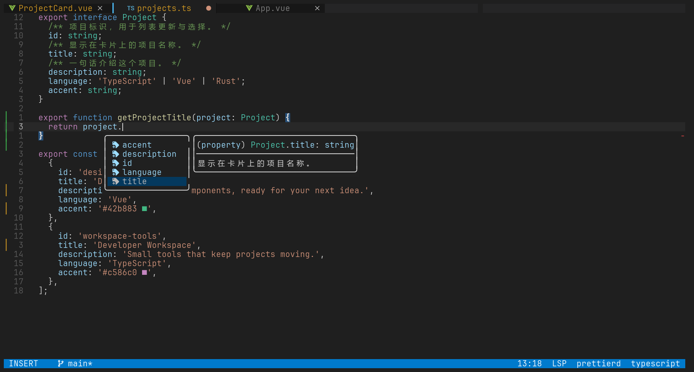

# Neovim 配置

除特别说明，先按 `Esc` 再使用快捷键。`空格 f f` 表示依次按下这三个键；`Alt+S` 表示同时按下。

忘记按键时，按空格查看后续选项，或按 `空格 ?` 打开快捷键速查：`j/k` 浏览，`i` 搜索，`Esc` 关闭。`?` 即 `Shift+/`。

## 查找与跳转

| 按键 | 操作 |
| --- | --- |
| `空格 f f` | 查找文件 |
| `空格 f p` | 选择项目 |
| `Alt+F` | 搜索当前文件，回车后用 `n/N` 查找下一处 / 上一处 |
| `空格 s g` | 搜索整个项目 |
| `空格 s r` | 搜索替换，默认当前文件，也可先选中文字 |
| `gd` | 查看定义；只有一个结果时直接跳转 |
| `grr` / `gri` / `grt` | 查找引用 / 实现 / 类型定义 |
| `grn` | 重命名变量、函数或标签 |
| `gra` | 查看当前位置或选中代码可执行的操作 |
| `grx` | 执行代码附近显示的操作，仅独立 Neovim，需项目支持 |
| `空格 c o` / `空格 c h` | 查看代码大纲 / 当前位置的说明 |
| `空格 j j` / `空格 j s` | 按屏幕提示跳转 / 选择代码 |
| `[x` / `]x` | 上一条 / 下一条错误或提示 |
| `空格 x f` / `空格 x x` | 查看当前文件 / 整个项目的错误与提示 |
| `Alt+U` / `Alt+I` | 返回上一个 / 前往下一个跳转位置 |
| `空格 s n` / `空格 s u` | 查看通知 / 撤销历史 |
| `空格 u c` | 选择配色主题 |

搜索列表中，按 `i` 输入，`j/k` 选择，`Enter` 确认，`Esc` 关闭。选择配色时，上下移动即可预览。

代码操作中，首次按 `Ctrl+L` 展开修改预览，焦点留在列表，`j/k` 选择其他动作时同步更新对比；再次按 `Ctrl+L` 进入预览，`Ctrl+H` 返回列表。`Enter` 执行动作，`Esc` 关闭整个菜单。仅独立 Neovim；无法完整预览的动作会显示原因。

引用预览中，`h/l` 收起 / 展开文件组，`Ctrl+H` 进入代码，`Ctrl+L` 返回列表，`Enter` 跳转，`q` 关闭。
代码大纲中，`Ctrl+L` 进入预览，`Ctrl+H` 返回列表。

HTML/Vue 中，`gra` 还可删除标签、移除外层标签、切换空标签写法，或给选中内容添加外层标签。

## 编辑与输入

| 按键 | 操作 |
| --- | --- |
| `Enter` | 开始在光标后输入；输入时换行或确认补全 |
| `s` | 删除光标处字符并开始输入 |
| `Shift+D` | 删除光标到行尾的内容 |
| `Alt+S` | 保存，输入时也可使用；保存时自动格式化 |
| `Alt+Shift+F` | 手动格式化，输入时也可使用 |
| `Alt+Z` / `Alt+Y` | 撤销 / 重做，输入或选中文字时也可使用 |
| `Alt+A` | 全选 |
| `Alt+D` | 删除当前行，输入时也可使用；已选中文字时删除选中内容 |
| `Alt+X` / `Alt+C` | 剪切当前行或选中内容 / 复制选中内容 |
| `Alt+V` | 粘贴，输入时也可使用；有选中文字时替换选中内容 |
| `Alt+/` | 注释当前行或选中的多行 |
| `Alt+J` / `Alt+K` | 下移 / 上移当前行或选中的多行 |
| `gh` / `gl` | 行首非空白处 / 行尾 |
| `Shift+G` / `gg` | 文件开头 / 文件结尾 |
| `Shift+J` / `Shift+K` | 向下 / 向上翻半页，无动画 |
| `空格 j w` / `空格 j b` / `空格 j e` | 下一个词段开头 / 上一个词段开头 / 词段末尾 |

词段移动会识别驼峰、下划线和数字边界。例如先按 `d`，再按 `空格 j e`，删除到词段末尾。

也可用 `gcc` 注释当前行，选中多行后按 `gc`；`gc` 后接移动按键可注释对应范围。换行不会自动续写注释前缀。

输入时，补全菜单会自动出现：

- 上下方向键或 `Alt+J/K` 选择，`Tab` 或 `Enter` 确认，`Ctrl+E` 关闭。
- 右侧说明较长时，用 `Ctrl+B` / `Ctrl+F` 向上 / 向下翻阅。
- 补全模板后，`Tab` / `Shift+Tab` 切换下一处 / 上一处待填内容。退出输入后仍可切换，再按 `Esc` 结束填写。
- 没有补全或待填内容时，`Tab` 跳过紧邻的右括号、引号，否则缩进。
- 输入 `>` 自动闭合标签；输入 `</` 后可选择结束标签。标签、样式缩写和类名也支持补全。

输入命令时，`Tab` 显示或确认补全，`Enter` 执行选中的命令。

`Esc` 可关闭说明窗口、清除搜索高亮或退出多处编辑；清除高亮后仍可用 `n/N` 继续查找。输入时先按一次退出输入。

原来的 `u`、`Ctrl+R`、`dd`、PageUp/PageDown 已禁用。删除或修改文本不会覆盖剪贴板；需要剪切请用 `Alt+X`。

## 选择代码与批量修改

先按 `v`，再用下表按键选择代码；也可接在 `d`、`c` 后删除或修改，例如 `daf` 删除整个函数，`vis` 选择语句内容。

| 内容 | 选择内部 | 选择整体 | 跳到上一个 | 跳到下一个 |
| --- | --- | --- | --- | --- |
| 函数 | `if` | `af` | `[f` | `]f` |
| 循环 | `il` | `al` | `[l` | `]l` |
| 条件分支 | `id` | `ad` | `[d` | `]d` |
| 调用 | `ic` | `ac` | `[c` | `]c` |
| 参数 | `ia` | `aa` | `[a` | `]a` |
| 语句 | `is` | `as` | `[s` | `]s` |
| 括号 | `ib` | — | `[b` | `]b` |
| 引号 | `iq` | — | `[q` | `]q` |

选中后，`Enter` 扩大选区，`Backspace` 沿原路径缩回。`;` / `,` 向后 / 向前重复结构跳转。
`is` 不包含结尾分号。Vue 模板中的循环、条件分支对应带 `v-for`、`v-if/v-else-if/v-else` 的标签，选择内部时不包含标签本身；空标签或自闭合标签没有内部选区。

`ib` / `iq` 优先选择当前行中包住光标的内容，其次选择下一处；当前行找不到时查找前后 50 行。

括号和引号的跳转会定位到起始位置，括号支持嵌套。

`f` / `t` 后输入字符，向后找到该字符 / 停在字符前；`Shift+F` / `Shift+T` 向前找到该字符 / 停在字符后，范围仅当前行。

需要同时修改多处时：

| 按键 | 操作 |
| --- | --- |
| `gb` | 选中当前词或已有选区，再按选中下一个相同内容；输入时也可使用 |
| `Alt+Shift+J` / `Alt+Shift+K` | 向下 / 向上添加光标；输入时也可使用 |
| `mc` | 手动添加光标；独立 Neovim 中再次按下可移除 |
| `mm` | 让所有光标一起移动，仅独立 Neovim |
| `mi` / `ma` | 在所有光标前 / 后输入 |

按 `Esc` 退出多处编辑；正在输入时按两次。

折叠代码：`za` 切换当前块，`zc` / `zo` 收起 / 展开；先按 `z` 再按 `Shift+M/R`，全部收起 / 展开。

## 文件、窗口与终端

| 按键 | 操作 |
| --- | --- |
| `Alt+B` / `Alt+E` | 开关文件树 / 定位当前文件 |
| `Alt+H` / `Alt+L` | 上一个 / 下一个文件标签 |
| `Alt+<` / `Alt+>` | 将文件标签向左 / 向右移动 |
| `Alt+1` ～ `Alt+3` | 切换到第 1～3 个文件标签 |
| `Alt+P` | 固定 / 取消固定文件标签 |
| `空格 w r` | 依次重新打开本次关闭的文件 |
| `空格 w v` / `空格 w s` | 左右 / 上下分屏 |
| `Ctrl+H/J/K/L` | 切换到左 / 下 / 上 / 右窗口 |
| `Alt+↑` / `Alt+↓` | 增加 / 减少窗口高度 |
| `Alt+←` / `Alt+→` | 减少 / 增加窗口宽度 |
| `Alt+W` | 关闭当前窗口或浮窗；最后一个编辑窗口关闭文件并保留布局 |
| `Alt+T` / `Alt+G` | 开关终端 / 代码助手，终端内也可使用 |
| `空格 q a` | 退出全部窗口；也可输入 `:qa`，`:q` 只关闭当前窗口 |

文件树中的操作：

| 按键 | 操作 |
| --- | --- |
| `Enter` 或空格 | 打开文件 / 展开目录 |
| `a` / `Shift+A` | 新建文件 / 文件夹 |
| `r` / `d` | 改名 / 删除 |
| `y` / `x` | 复制 / 剪切，选中目标目录后按 `p` 粘贴 |
| `Backspace` / `Tab` | 返回上级目录 / 将选中目录设为根目录 |
| `Shift+O` | 在系统文件管理器中打开所在目录 |

`空格 w r` 只恢复已关闭的文件；单独关闭分屏不会计入记录。`Alt+W` 也可关闭帮助页、结果列表、文件树和浮窗。

## 查看修改与提交

| 按键 | 操作 |
| --- | --- |
| `空格 g d` | 对比文件修改 |
| `空格 g h` | 查看修改历史 |
| `空格 g t` | 打开提交与分支管理界面 |

对比界面中的操作：

| 按键 | 操作 |
| --- | --- |
| `Alt+B` / `Alt+E` | 开关文件列表 / 进入文件列表 |
| `Tab` | 将当前文件加入 / 移出“已暂存”组，决定下次提交包含哪些修改 |
| `[c` / `]c` | 上一个 / 下一个修改块 |
| `[f` / `]f` | 上一个 / 下一个文件 |
| `d` | 在文件列表中放弃该文件的修改 |
| `q` 或 `Alt+W` | 退出对比 |

选中文件夹时，`Tab` 会处理整个文件夹。

## 调试

| 按键 | 操作 |
| --- | --- |
| `空格 d b` | 添加 / 移除断点 |
| `F5` | 启动或继续；Rust 首次需选择运行目标 |
| `F10` / `F11` / `F12` | 执行下一步 / 进入函数 / 跳出函数 |

Node.js 调试弹出线程选择时，选择 `Resume stopped thread`。

## 安装与更新

准备 Neovim 0.12+、Git、Node.js/npm、ripgrep、C 编译器，以及可用的 tar、curl 和解压工具，加入 PATH。

| 环境 | 安装示例或补充要求 |
| --- | --- |
| Windows | `scoop install neovim git nodejs-lts ripgrep gcc` |
| Windows 终端 | 使用 PowerShell，并执行 `npm install -g @microsoft/inshellisense` |
| macOS | `brew install neovim git node ripgrep`；编译工具用 `xcode-select --install` |
| Rust 项目 | 另装 Rust 工具链、rust-analyzer、rustfmt；Windows/MSVC 还需 C++ Build Tools 和 Windows SDK |

提交管理界面需安装 `lazygit`，代码助手需安装 `opencode`。VS Code 中使用需安装 `vscode-neovim` 扩展，并先在独立 Neovim 完成首次安装。建议使用带图标的字体。

将[本仓库](https://github.com/so11y/nvim)克隆到 Windows 的 `%LOCALAPPDATA%\nvim` 或 macOS 的 `~/.config/nvim`，再启动 Neovim。已有配置先备份，安装需访问 GitHub 和 npm。

| 操作 | 输入命令 |
| --- | --- |
| 首次安装 | `:Lazy install`，完成后重启 |
| 更新 | `:Lazy update` |
| 补装语言工具 | `:Lazy build mason.nvim` |
| 补装语法支持 | `:Lazy build nvim-treesitter` |

启动时不会自动补装。安装或更新失败时查看 `:Lazy`、`:MasonLog`。

维护与测试见[验证说明](scripts/verification/README.md)。
